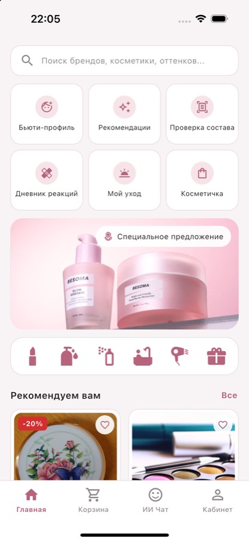
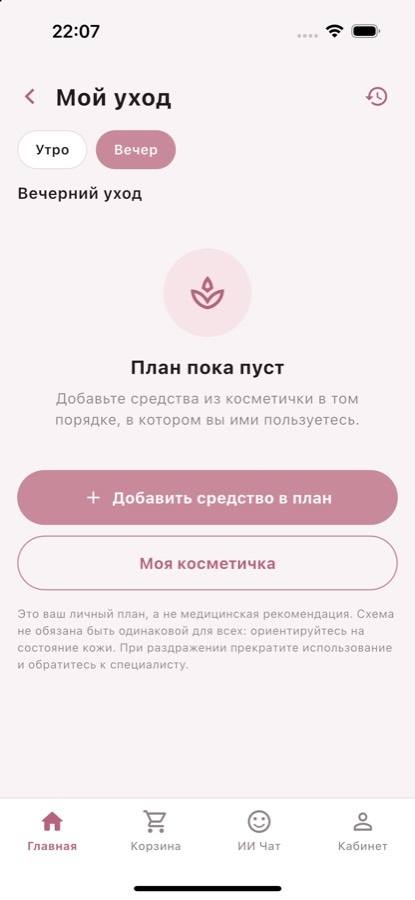

# Cosmetix

Мобильное Flutter-приложение для сравнения цен на косметику, анализа состава
и подбора ухода по бьюти-профилю. Дизайн повторяет макет Figma (22 экрана),
все данные хранятся локально в **SQLite** — сервер не нужен.

> Курсовая работа. Приложение работает полностью офлайн: после первого запуска
> база создаётся и заполняется демо-данными.

## Стек

| Что | Версия / пакет |
| --- | --- |
| Flutter | 3.44 (stable) |
| Dart | 3.12 |
| Локальная БД | `sqflite` + `path` |
| State management | `provider` |
| Хэш пароля | `crypto` (SHA-256 с солью) |
| Локализация виджетов (русский date picker) | `flutter_localizations` |
| Тесты | `flutter_test`, `sqflite_common_ffi` (SQLite в памяти) |

Минимум зависимостей: ничего лишнего (нет Bloc, нет GetIt, нет `intl`).

## Быстрый старт

```bash
flutter pub get
flutter run          # выберите iOS-симулятор / Android-эмулятор / macOS
```

Демо-аккаунт (создаётся при первом запуске):

| Email | Пароль |
| --- | --- |
| `ainara.rust@gmail.com` | `Cosmetix123` |

На экране входа кнопка ✦ в правом верхнем углу подставляет эти данные.
Можно также зарегистрировать новый аккаунт.

Проверка качества:

```bash
dart format .
flutter analyze      # No issues found
flutter test         # ~190 тестов
(cd server && node --test)   # 15 тестов прокси
```

## Архитектура

Простая слоистая схема, которую легко объяснить:

```
Screen (UI)  →  Provider (состояние)  →  Repository (SQL)  →  SQLite
```

* **Screen** — только отображение и обработка нажатий, SQL-запросов в UI нет.
* **Provider** (`ChangeNotifier`) — хранит состояние экрана и вызывает репозиторий.
* **Repository** — все SQL-запросы к `sqflite`.
* **Services** — чистая логика без UI/БД: анализ состава, тест цветотипа,
  ИИ-ассистент (клиент прокси: Gemini или Claude), распознавание состава.

### Структура папок

```
lib/
  main.dart                 запуск
  app.dart                  создание репозиториев/провайдеров, MaterialApp
  core/
    theme/                  AppColors, AppTheme, AppTextStyles, AppDimensions
    constants/              категории, тексты политики/условий
    utils/                  валидаторы, форматтеры цен/дат, SnackBar/Dialog
  models/                   Product, AppUser, CartItem, Order, Review, ...
  database/
    database_helper.dart    схема, onCreate/onUpgrade, resetDemoData
    seed_data.dart          демо-данные
  repositories/             user, product, cart, safety, review, chat, settings
  services/                 assistant, ingredient_analyzer, color_test
  providers/                auth, catalog, cart, safety, chat, settings, nav
  routes/                   app_routes.dart (все маршруты), route_args.dart
  widgets/                  CustomButton, CustomTextField, ProductCard,
                            ProductArt, AppBottomNav, PageScaffold, ...
  screens/                  auth, home, catalog, product, cart, chat,
                            profile, beauty, safety (по одному файлу на экран)
test/                       validators, logic, database, widget
```

## База данных SQLite

Файл `cosmetix.db` (в каталоге баз приложения). Версия схемы — `6`
(`DatabaseHelper.dbVersion`). `onCreate` создаёт таблицы и демо-данные,
при смене версии `onUpgrade` выполняет миграции (данные не удаляются, см. «Миграции базы данных»). Включены `FOREIGN KEY`.

| Таблица | Содержимое |
| --- | --- |
| `users` | аккаунт, контакты, бьюти-профиль, бонусы, посещения |
| `settings` | настройки (тема, валюта, push) и id текущего пользователя |
| `stores` | магазины (расстояние, адрес, рейтинг) |
| `products` | товары каталога |
| `product_prices` | цена товара в каждом магазине (связь product ↔ store) |
| `favorites` | избранное пользователя |
| `cart_items` | корзина (товар + магазин + количество) |
| `orders`, `order_items` | оформленные заказы |
| `reviews` | отзывы к товарам |
| `search_history` | история поиска |
| `ingredients`, `product_ingredients` | состав товаров |
| `blacklist` | чёрный список компонентов пользователя |
| `reactions` | дневник кожных реакций |
| `chat_messages` | переписка с ИИ-помощником |
| `my_products` | косметичка пользователя (даты, срок после вскрытия) |
| `care_steps`, `care_logs` | утренний/вечерний план и история применения |
| `reaction_history` | история изменений записей дневника |

### Как сбросить / пересоздать демо-базу

* В приложении: **Кабинет → Настройки → Сбросить демо-данные**
  (удаляет все данные и заново создаёт демо-набор).
* Вручную: удалить приложение с устройства/симулятора или файл `cosmetix.db`.
* В коде: `DatabaseHelper().resetDemoData()`.

## Экраны

**Из Figma:** Вход, Регистрация, Забыли пароль, Главная, Каталог, Поиск,
Фильтры, Корзина, О товаре, Сравнение цен, Отзывы, Анализ состава,
ИИ-помощник, Профиль, Редактирование профиля, Избранное, Бьюти-профиль,
Тест цветотипа, Тест на подтон, Настройки, Чёрный список, Дневник реакций.

**Добавлены, чтобы сценарии были законченными:** Покупки (история заказов),
Заказ оформлен, Новый пароль, Добавить/изменить реакцию, Результат теста
цветотипа, Политика конфиденциальности / Условия использования.

## Основные функции

* Регистрация, вход, восстановление пароля, сессия сохраняется между запусками.
* Каталог с живым поиском, чипами зон (Лицо/Глаза/Губы/Тело), сортировкой и
  экраном фильтров (категория, статус, диапазон цены, счётчик «найдено N»).
* Избранное (хранится в SQLite), история поиска, популярные категории.
* Карточка товара: цены в 3 магазинах, выбор магазина, анализ состава,
  отзывы (создание, редактирование, удаление своих).
* Корзина: количество, сортировка/фильтры, оформление заказа, бонусы: 2 % кэшбэк за заказ и списание накопленных бонусов при оплате (1 бонус = 1 ₸; при удалении заказа бонусы пересчитываются).
* Анализ состава: оценка 0–10, аллергены, предупреждение о компонентах из
  чёрного списка.
* Бьюти-профиль и тест цветотипа (5 шагов + тест подтона → результат).
* Дневник реакций: полный CRUD.
* ИИ-помощник: Gemini или Claude через прокси `server/` (см. «ИИ-консультант»); сравнение цен, состав,
  скидки, подбор.
* Настройки: тема (светлая/тёмная), валюта (₸/₽/$), push-флаг, выход.

## Пользовательские сценарии

1. **Покупка:** Вход → Главная → товар → выбор магазина → «В корзину» →
   Корзина → «Оформить заказ» → подтверждение → «Заказ оформлен» → Покупки.
   Бонусы в профиле увеличиваются и сохраняются.
2. **Поиск и избранное:** Поиск → запрос (попадает в историю) → Каталог →
   сердечко → Кабинет → Избранное (после перезапуска остаётся).
3. **Безопасность состава:** Чёрный список → включить «Парабены» → открыть товар →
   Анализ состава → красное предупреждение.
4. **Цветотип:** Кабинет → Цветотип → «Пройти тест заново» → 5 вопросов →
   тест на подтон → результат сохраняется в профиле.
5. **Дневник реакций:** Кабинет → Дневник аллергии → добавить / изменить /
   удалить запись (с подтверждением удаления).
6. **Аккаунт:** Забыли пароль → «письмо» с 6-значным кодом → ввод кода и нового пароля → вход.

## Course Requirements

| Требование | Как выполнено |
| --- | --- |
| Интерфейс максимально соответствует Figma | Палитра, радиусы, карточки, BottomNavigationBar, типографика повторяют макет; градиентов нет |
| Все экраны Figma существуют | 22 экрана + 6 добавленных |
| Повторяющиеся элементы — отдельные виджеты | `lib/widgets/` |
| Все кнопки/карточки/иконки работают | Нет пустых `onPressed`; действия или навигация у каждого элемента |
| Навигация, возврат назад | Централизованные маршруты `AppRoutes`, стрелка «назад», BottomNavigationBar на всех основных экранах |
| Валидация форм | `Form` + `validator` (`core/utils/validators.dart`): email, пароль, телефон, цены, длина текста |
| Ошибки, предупреждения, подтверждения, успех | SnackBar (4 типа), AlertDialog, bottom sheet, inline-ошибки, пустые состояния |
| Основной сценарий проходится целиком | См. «Пользовательские сценарии» |
| Локальная БД без backend | SQLite (`sqflite`), данные сохраняются между запусками |
| CRUD | Реакции, отзывы, корзина, профиль, чёрный список, заказы |
| Подтверждение удаления | `confirmDialog` перед каждым удалением |
| Поиск / фильтры / избранное | Работают по реальным данным, избранное в SQLite |
| Структура проекта, не один `main.dart` | См. «Структура папок» |
| Тесты | 117 тестов: валидаторы, фильтры, репозитории, миграции, анализ состава, хэширование паролей, бонусы, переводы, виджет-тесты (вход, сброс пароля, корзина) |
| Работа без внешнего backend | Всё локально; Google/Apple/«письмо» — локальная имитация |

## Отличия от Figma

* Добавлена вкладка **«Главная»** в нижнее меню — в макете до каталога и
  поиска нельзя было дойти.
* Фото товаров нарисованы встроенными иллюстрациями (`ProductArt`), так как
  изображения нельзя было выгрузить из закрытого файла Figma.
* Вход через Google/Apple и отправка письма для сброса пароля — локальная
  имитация (без сервера).
* Язык интерфейса: русский, английский и казахский (Кабинет → Настройки).

## Фотографии товаров

Реальные фото лежат в `assets/photos/` (Wikimedia Commons, свободные
лицензии). Авторы и лицензии — в `assets/photos/CREDITS.txt`. Для товаров без
фото (`box`) рисуется локальная иллюстрация.

## Персонализация и бьюти-профиль

* **Бьюти-тест**: 5 вопросов цветотипа → тест на подтон (вены) → вопросы о коже
  (тип кожи, проблемы) → **необязательное фото** → итоговый «Бьюти-профиль».
  Фото можно пропустить: результат тогда строится только по ответам.
* Итоговый профиль = опросник + (по желанию) анализ фото. Если они расходятся,
  **побеждают ответы пользователя**; фото лишь заполняет пробел (подтон
  «нейтральный» при уверенном анализе) и не влияет на тип кожи.
* **Рекомендации** считает `RecommendationService` (обычный Dart + SQLite,
  без ИИ): чёрный список (жёсткое исключение) → тип кожи и проблемы → цветотип и
  подтон (для декоративной косметики) → новизна. Результат — оценка совпадения
  в процентах и причины («Почему это подходит вам»).
* До теста каталог сортируется **по новизне**; после — **«Для вас»**
  (доступны: Для вас, По новизне, Дешёвые, Дорогие). Ручной выбор сортировки
  сохраняется на время визита. На главной появляется «Рекомендуем вам».
* Чёрный список главнее любого ИИ: товар с включённым компонентом никогда не
  попадает в персональные рекомендации (тесты в `test/recommendation_test.dart`).
* Свойства товаров — в нормализованных таблицах `product_skin_types`,
  `product_color_types`, `product_undertones`, `product_concerns`,
  `product_tags` (источник `seed` или `ai`); ответы ИИ-классификатора
  кэшируются в `product_ai_classification` и не запрашиваются повторно.

## Миграции базы данных

Версия схемы — 6. Обновление **не удаляет данные**: `DatabaseHelper._migrations`
выполняет шаги по порядку (v4: `avatar_path`, метаданные бьюти-профиля, таблицы
свойств товаров + заполнение для существующих товаров; v5: `orders.bonus_spent` — списанные бонусы; v6: `my_products`, `care_steps`, `care_logs`, `reaction_history`, `reactions.photo_path`, `users.preferences`, `users.reco_use_history`). Новая установка проходит
те же шаги, поэтому схемы совпадают (тест `test/migration_test.dart`).
Новая миграция = новая запись в `_migrations` и увеличение `dbVersion`.

## ИИ-консультант (Gemini или Claude)

Консультант работает через **Gemini API (Google)** или **Claude API (Anthropic)**, но приложение **никогда не
содержит ключ**: оно обращается к небольшому серверу-прокси из папки
[`server/`](server/README.md), а ключ лежит только в переменных окружения
сервера.

```
Cosmetix (iPhone)  ──HTTP──▶  server/ (Node, без зависимостей)  ──HTTPS──▶  Gemini / Claude API
                              ключ, лимиты, бюджет токенов
```

**Запуск (Mac, Node 20+):**

```bash
cd server
cp .env.example .env     # впишите GEMINI_API_KEY или ANTHROPIC_API_KEY (файл в .gitignore)
node index.js
```

Без ключа прокси работает в **тестовом режиме**: ответы помечены
`[ТЕСТОВЫЙ РЕЖИМ …]`, структурные запросы отклоняются, ничего не уходит
провайдеру ИИ. Проверка: `tool/check_ai.sh http://127.0.0.1:8787`.

**Приложение:** адрес сервера задаётся в **Кабинет → Настройки →
ИИ-ассистент** или при сборке:

```bash
flutter run --dart-define=AI_BASE_URL=http://127.0.0.1:8787
```

(в iOS Simulator `127.0.0.1` — это ваш Mac; на реальном iPhone укажите IP Mac в
Wi-Fi.) Если серверной части нет или она недоступна, остальные функции работают.

* **Провайдер** выбирается по ключу: `GEMINI_API_KEY` → Gemini (модель по умолчанию
  `gemini-3.1-flash-lite`, переменная `GEMINI_MODEL`), `ANTHROPIC_API_KEY` → Claude
  (`claude-haiku-5-5`, `CLAUDE_MODEL`); `AI_PROVIDER=gemini|claude` задаёт явно.
  Названия моделей Gemini меняются часто (старые закрываются для новых ключей):
  актуальный список — `GET https://generativelanguage.googleapis.com/v1beta/models`.
* **Бесплатный ключ Gemini:** у Google есть лимиты и «высокий спрос» (503): прокси
  делает до двух повторов. Запросы на бесплатном уровне могут использоваться
  Google для улучшения продуктов, поэтому для реальных пользователей с личными
  данными и фото берите платный ключ.
* **Контроль расходов:** `MAX_OUTPUT_TOKENS` (600), `RATE_LIMIT_PER_MIN` (20),
  `DAILY_TOKEN_BUDGET` (200 000), лимиты длины запроса; в приложении сообщение
  ≤ 500 символов, история — 8 сообщений, каталог в промпте — до 60 товаров.
* **Ошибки:** нет сети / таймаут / лимит (429 с «попробуйте через N с») /
  недоступность API — понятное сообщение в чате и кнопка «Повторить».
* **Согласие:** профиль и чёрный список уходят в ИИ только с разрешения
  (спрашивается при первом сообщении, меняется в Настройках); фото — только с
  отдельного разрешения и удаляется после анализа. Без согласия товары с
  запрещёнными компонентами просто не попадают в каталог для ИИ.
* ИИ не должен выдумывать товары, цены и составы, не ставит диагнозов и не
  обещает отсутствие аллергии (правила в системном промпте, проверяются
  тестами).

## Новые разделы

* **Проверка состава** (главная → «Проверка состава»): фото из галереи или
  камеры → текст распознаётся **на телефоне** (Apple Vision, фото никуда не
  отправляется) → список можно исправить → сравнение с личным чёрным списком с
  объяснением каждого совпадения. Если распознавание недоступно, состав
  вводится вручную. Тестовые картинки: `tool/sample_labels/`
  (`xcrun simctl addmedia booted tool/sample_labels/label_en.png`).
* **Моя косметичка:** средства с датой покупки/вскрытия, значком «срок после
  вскрытия» (PAO) и датой на упаковке; напоминание появляется только если
  данных упаковки достаточно.
* **Мой уход:** утренний и вечерний план из косметички, отметки «использовано
  сегодня», история за 30 дней. Это личный план, а не медицинская
  рекомендация.
* **Дневник реакций:** фото, история изменений каждой записи и блок
  «Повторяющиеся наблюдения» (с оговоркой, что совпадение не доказывает
  причину).
* **Рекомендации:** личные предпочтения («без отдушки», «натуральный состав»)
  и — только с согласия — история реакций и косметичка.
* **Главная:** шесть быстрых плиток (профиль, рекомендации, состав, дневник,
  уход, косметичка).

## Скриншоты (iPhone 16, iOS 18.0 Simulator)

 

## Запуск в iOS Simulator и интеграционные тесты

```bash
flutter pub get
xcrun simctl list devices available        # выберите iPhone
flutter devices
flutter run -d <ID> --dart-define=AI_BASE_URL=http://127.0.0.1:8787
flutter test integration_test -d <ID>      # 16 сценариев на выбранном iPhone
```

Нужны Xcode и CocoaPods (`brew install cocoapods`). Минимальная версия iOS — 15.
Интеграционные тесты используют поддельный ИИ-прокси и поддельный OCR; выбор
фото в системной галерее и настоящий Apple Vision проверяются вручную.

## Безопасность данных (локально)

* Пароли хранятся как PBKDF2-HMAC-SHA256 со случайной солью для каждого
  пароля (`core/utils/password_hasher.dart`). Хэши старых сборок продолжают
  работать и обновляются при первом входе.
* Вход «через Google/Apple» — локальная имитация: такой аккаунт создаётся
  **без пароля** и не открывается формой email + пароль.
* Восстановление пароля: «письмо» имитируется, код (6 цифр, действует 10 минут,
  5 попыток) показывается в диалоге. Экран не раскрывает, зарегистрирован ли
  email.
* Фото (аватар, фото отзывов) хранятся в БД как `avatars/<файл>` и
  `review_photos/<файл>`, а не как абсолютные пути: на iOS путь к папке
  приложения меняется после обновления (`core/utils/app_paths.dart`).
* «Сбросить демо-данные» выполняется одной транзакцией, удаляет сохранённые фото
  и сбрасывает адрес ИИ-сервера.
