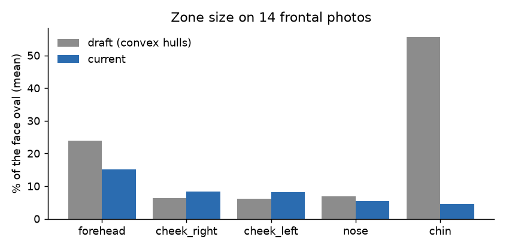
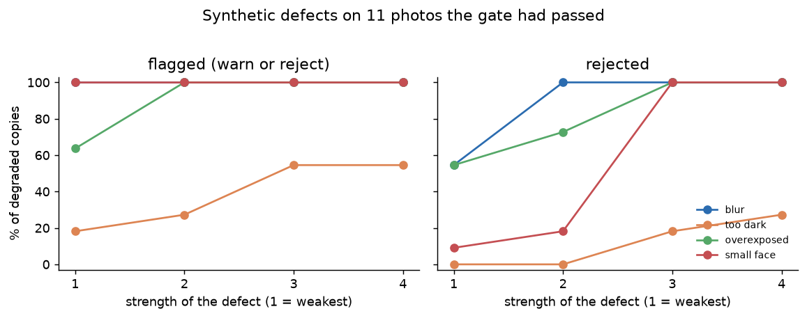
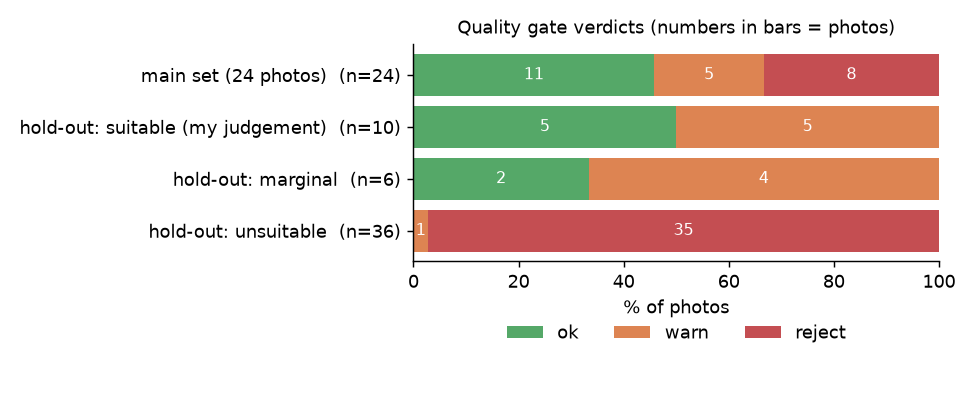
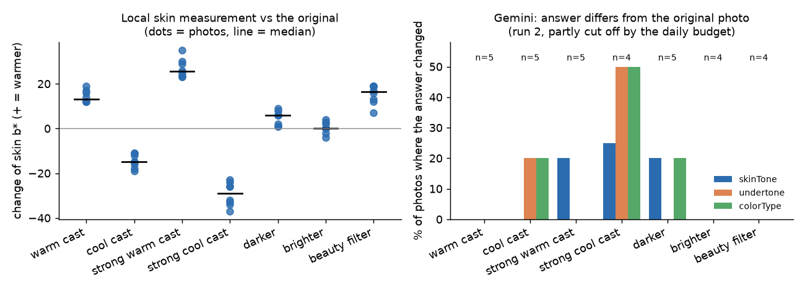
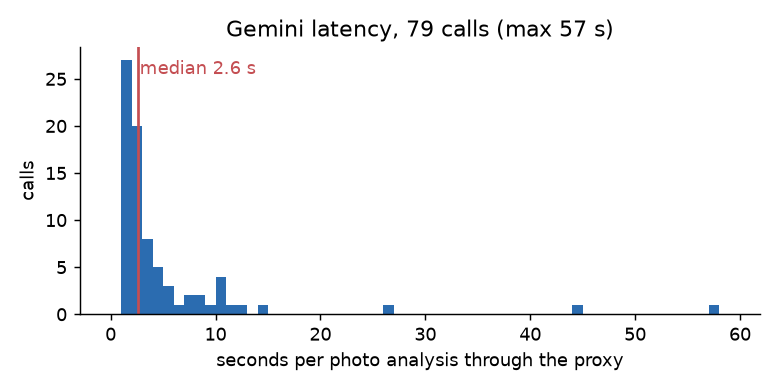
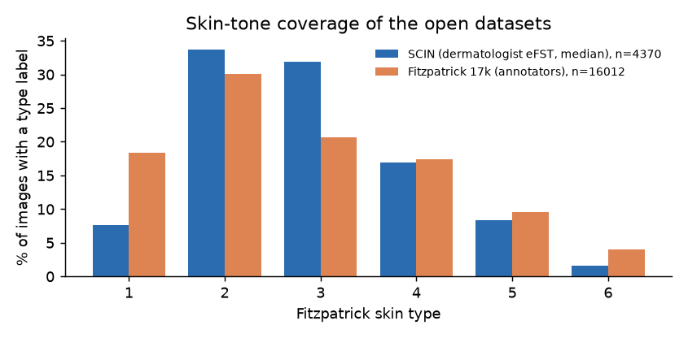

# Cosmetix: аудит анализа кожи и цветотипа

Дата: 5 ноября 2026. Ветка `eval/skin-analysis-audit` (от `main` с PR #22). Платформа: только iOS, Android не проверялся.

**Правило отчёта:** каждая цифра получена запуском скриптов из `tools/eval/` или прочитана в первоисточнике по ссылке;
что не измерено, названо прямо. Фразы «Точность не установлена» стоят там, где нет независимой разметки.
Повторяемость ответа Gemini не выдаётся за достоверность.

## 0. Главное за одну страницу

| Вопрос | Ответ | Основание |
|---|---|---|
| Определяет ли Cosmetix акне, рубцы, покраснения, пигментацию, текстуру по фото? | **Нет. Такого детектора в приложении нет.** «Проблемы кожи» берутся из анкеты пользователя | §1, код |
| Чем анализируется фото? | Только Gemini (языковая модель) через прокси `server/`: тон кожи, подтон, цветотип. Локальных вычислений по фото нет; MediaPipe в анализе не участвует (он только в виртуальной примерке) | §1 |
| Насколько точен цветотип/тон/подтон? | **Точность не установлена**: нет независимой разметки | §4, §6 |
| Можно ли доверять показанной «Уверенности анализа фото: N %»? | **Нет.** Это число, которое модель сама назвала; оно не калибровалось и не проверялось | §1, §3 |
| Что будет с фото без лица, групповым, в очках, снятым сбоку? | На 36 неподходящих фото набора проверки **24 ответа приложение приняло бы в профиль** (уверенность ≥ 0,6) | §3 |
| Может ли приложение показать пользователю неподтверждённые утверждения о коже? | **Да.** В 30 из 79 ответов Gemini в «наблюдениях» (их показывает экран результата) есть утверждения о текстуре, блеске, покраснениях, пигментации | §3 |
| Что сделано в стенде? | Code-review PR #18 (11 замечаний, все исправлены), README с нуля даёт побайтово те же результаты, добавлена отложенная выборка из 52 фото, проверка устойчивости, расчёты по открытым наборам | §2, §3, §5 |
| Что нужно решить до App Store? | См. §9; самое срочное: уточнить, бесплатный ли ключ Gemini (для бесплатной квоты Google может использовать фото и показывать людям) | §9 |

## 1. Что реально делает существующая реализация (по актуальному `main`, `73db1a2`)

Всё ниже прочитано в коде; в скобках файл и строка.

| Вопрос | Факт |
|---|---|
| **Какие модели и библиотеки анализируют фото** | Одна: **Gemini** (по умолчанию `gemini-3.1-flash-lite`, `server/app.js:54`), через прокси `server/`. Если у прокси задан ключ Claude, отвечает Claude (`claude-haiku-5-5`, `server/app.js:53`). В приложении нет OpenCV, TFLite-классификатора, CoreML-модели кожи. Apple Vision используется только для OCR состава (`ios/Runner/AppDelegate.swift`). |
| **Локально или через Gemini** | Через Gemini. Фото уменьшается пикером до 1024 px, качество 80 (`beauty_photo_screen.dart:78-80`), без проверки качества, без поиска лица, и отправляется после согласия пользователя (`beauty_photo_screen.dart:103-115`). |
| **Что определяет алгоритм** | `skinTone` (5 значений), `undertone` (3), `colorType` (4), `confidence` (0–1, **сама модель**), до 4 строк `observations` и `explanation` (`vision_analyzer.dart:21-34`). Температура 0,2, JSON-режим (`vision_analyzer.dart:43`). |
| **Отдельное обнаружение акне, рубцов, покраснений, пигментации, текстуры** | **Нет.** В промпте это прямо запрещено («Do not describe diseases or skin conditions», `vision_analyzer.dart:33`). Раздел «ПРОБЛЕМЫ КОЖИ» на экране результата это список из **анкеты**, а не из фото (`beauty_test_flow.dart`: `concerns` передаются из ответов пользователя). |
| **Как определяется цветотип** | Два пути. (1) **Анкета**: 8 вопросов + жилы; у каждого ответа ручные баллы тепла/глубины/контраста, из сумм правилами выбирается один из четырёх сезонов (`color_test_service.dart`). Источника для весов и порогов в коде нет, проверки на людях нет. (2) **Фото через Gemini**. Анкета главнее: фото подставляется, только если отвечено меньше 4 вопросов (`minAnswers = 4`), и заменяет «нейтральный» подтон на тёплый/холодный (`beauty_profile_merger.dart`). |
| **Где используется MediaPipe** | Только в виртуальной примерке макияжа (`lib/features/virtual_makeup/`), через пакет `mediapipe_face_mesh`; модели и лицензии разобраны в `docs/mediapipe-models-license-audit.md`. Анализ тона и цветотипа его **не** использует. |
| **Что реальное вычисление, а что сгенерировано моделью** | Вычисление: баллы анкеты. Сгенерировано языковой моделью: тон, подтон, цветотип по фото, `confidence`, `observations`, `explanation`. Ни одно из них не проверено на независимых данных. |
| **Может ли приложение выдать неподтверждённый вывод о коже** | **Да.** Экран результата печатает «Уверенность анализа фото: N %» (`color_result_screen.dart:140`) и каждую строку `observations` (`color_result_screen.dart:145`). Фильтра нет. В §3 показано, что строки содержат утверждения о текстуре, покраснениях, пигментации. |
| **Порог доверия к фото** | `confidence >= 0.6` (`beauty_profile_merger.dart:27,33`), то есть решает число, названное самой моделью. |
| **Тесты в приложении** | `test/ai_test.dart` и др. проверяют разбор JSON, слияние профиля и ошибки. Правильность ответов, устойчивость и качество фото **ничем не проверяются**. |

Вывод: **ни одна функция не является «точным детектором акне или рубцов»**: такой функции нет. Анализ цветотипа по фото это
ответ языковой модели без независимого подтверждения.

## 2. Тестовый стенд: ревью, исправления, воспроизводимость

### 2.1. Code-review PR #18

Выполнен полный `/code-review` (высокий уровень, 8 углов), 11 замечаний. Все исправлены в этой ветке; 3 из них (каппа, BOM, крен) я подтвердил
запуском до исправления.

| № | Было | Стало |
|---|---|---|
| 1 | Взвешенная каппа считала расстояние по номеру среди встретившихся уровней: на одних и тех же ответах 0,5714 при уровнях {0,1,3} и 0,4706 при {0,1,2,3} | Расстояние по значению уровня; тест |
| 2 | CSV читался как `utf-8`: файл из Excel с BOM давал `KeyError 'image'` | `utf-8-sig`, пробелы убираются, понятная ошибка с файлом и строкой |
| 3 | Неверное значение (`'2.0'`, `mild`) ронял весь расчёт без указания строки | `1.0`/`2.0` принимаются, остальное: ошибка с файлом, строкой и колонкой; код выхода 2 |
| 4 | Оценка поворота головы не учитывала наклон: p035 с креном 22,8° получал «поворот» 0,263 | Считается вдоль линии глаз; тесты на крен 25° |
| 5 | `run_quality_eval.py` падал на фото без лица | Такое фото считается отклонённым |
| 6 | Пороги подобраны и «проверены» на одних и тех же 24 фото | Отложенная выборка из 52 фото (§5.1); пороги **не** перенастраивались, одно правило добавлено после и помечено |
| 7 | В `gemini_repeat.py` разные итоговые строки считались по разным наборам запусков, допустимые значения строже, чем в приложении | Один набор, те же синонимы, что в `VisionAnalysis.parse` |
| 8 | Фото сохранялись без проверки, библиотеки и модель без версий | JPEG-сигнатура и SHA-256 (хэши записаны в манифест), версии в `requirements.txt`, SHA-256 модели |
| 9 | Для групповых фото бралось первое из двух лиц | До 5 лиц считаются, анализируется самое большое |
| 10 | Код картинок дублировался в двух скриптах, маски считались дважды | `viz.py`, `measure(..., masks)` |
| 11 | Тестировались только формулы метрик (9 тестов) | +14 тестов: поворот, пороги фильтра, чтение файлов, проверка фото (всего 23, проходят) |

### 2.2. README с нуля в чистой среде

Скопировал `tools/eval` без данных, моделей, результатов и окружения в пустую папку и выполнил команды README дословно: новая
виртуальная среда Python 3.12.12, `pip install -r requirements.txt`, `fetch_model.py`, `fetch_photos.py`, тесты, `run_face_eval.py`.

| Проверка | Результат |
|---|---|
| Тесты в чистой среде | 23 из 23 проходят |
| Скачано и проверено фото / модель | 24 из 24, хэши совпали; модель SHA-256 `64184e22…c9ff` |
| `zones_stats.csv` и `quality.csv` чистой среды против рабочей | **Побайтово совпадают** |
| `pip freeze` | Одинаков, кроме лишнего `opencv-python-headless` в рабочей среде (старая инструкция ставила его вместе с `opencv-contrib-python`, который и так требует mediapipe; два пакета `cv2` перезаписывают файлы друг друга, теперь в `requirements.txt` только contrib) |
| Что нашлось и исправлено | `python3.12` на этой машине доступен только через `PYENV_VERSION`; README говорит «Python 3.12», без привязки к команде |

Ограничение: совпадение проверено на **одном** Mac (Apple M1, macOS 27.0.1, Python 3.12.12, mediapipe 1.2.2, opencv 5.0.0.93,
numpy 2.5.4). На другом процессоре или ОС результат не проверялся.

### 2.3. Сопоставление фото и результатов

Всё связывается по имени файла/идентификатору из манифеста. (а) `skin_eval.py` теперь
останавливается с ошибкой, если ни одно имя в предсказаниях не совпало с метками (раньше молча считал «нет ответа»). (б) Я сверил руками два ответа с
картинками: `h012` (капюшон закрывает лицо) получил от Gemini «лицо скрыто камерой» с уверенностью 0,1, `h007` (две девушки в зеркале) получил «У обеих девушек…»:
результат лежит у своего фото. Это выборочная проверка, не доказательство для всех 52.

### 2.4. Исправления к отчёту PR #18

* **Скорость.** Цифры PR #18 (Face Landmarker в среднем 57 мс) измерены на загруженной машине (load average 29–47). На свободной машине (load 3–5): детектор **14,1 мс** в среднем (p95 14,5), маски зон 9,1 мс, метрики качества 21,2 мс на фото (720 запусков детектора по 24 фото; процессор M1). Это сходится с 14,7–16,4 мс из первого документа. Скорость на iPhone не измерялась.
* **Пороги качества.** После поправки крена на основном наборе: `ok` 11, `warn` 5, `reject` 8 (раньше 12/5/7): чёрно-белое p003 раньше проходило как `ok`, теперь отклоняется правилом «ч/б».
* **Размер зон.** На 14 фронтальных фото (раньше 15, из-за поправки крена): щёки 8,4 и 8,2 % площади лица против 6,3 и 6,2 % в черновике, подбородок 4,5 % против 55,5 %.

## 3. Устойчивость: что делает приложение с плохими фото

### 3.1. Фильтр качества: ловит ли он плохие фото

Две проверки, **обе предварительные**: пороги эвристические и подобраны на основном наборе из 24 фото.

**(а) Искусственные дефекты** (11 фото, которые фильтр пропускал). Доля испорченных копий, которые фильтр пометил:

| Дефект, уровень 1 → 4 | помечено (warn или reject) | отклонено |
|---|---|---|
| Размытие | 100 / 100 / 100 / 100 % | 55 / 100 / 100 / 100 % |
| Пересвет | 64 / 100 / 100 / 100 % | 55 / 73 / 100 / 100 % |
| Мелкое лицо | 100 / 100 / 100 / 100 % | 9 / 18 / 100 / 100 % |
| **Тёмное фото** | **18 / 27 / 55 / 55 %** | **0 / 0 / 18 / 27 %** |

Тёмные фото фильтр ловит плохо (светлокожие снимки остаются «яркими» в самой светлой части): **это слабое место**.

**(б) Отложенная выборка из 52 лицензированных фото** (`build_holdout_manifest.py`: случайная выборка с фиксированным зерном
из категорий Wikimedia Commons «селфи», очки, макияж, группы, силуэты, борода, пожилые лица, и 6 фото без лиц; детей и неподходящие кадры я убрал по
соображениям приватности, 8 фото, список с причинами в `photos_holdout_excluded.json`).

Мою оценку «подходит / сомнительно / не подходит для анализа» я записал по картинке (`holdout_judgement.json`). Это **один оценщик**, не независимая разметка.

| моя оценка \ фильтр | ok | warn | reject | всего |
|---|---|---|---|---|
| подходит | 5 | 5 | 0 | 10 |
| сомнительно | 2 | 4 | 0 | 6 |
| не подходит | 0 | 1 | 35 | 36 |

* Отказано в подходящих: **0 из 10** (95 % интервал Уилсона для доли ложных отказов 0–28 %; выборка мала).
* Не подходящих отклонено **35 из 36** (интервал 86–99,5 %). Пропущено одно (h016: солнечные очки, очень тёмно, язык).
* Правило «чёрно-белое» (цветность кожи < 2) добавлено **после** этой проверки: два чёрно-белых фото выборки (h002, h015) прошли с `warn`, а p003 основного набора получал `ok`. До правила отклонено 33 из 36 (интервал 78–97 %), пропущены h002, h015, h016. Выборка частично «испорчена» этим правилом, и это нужно помнить.
* Лицо найдено на 29 из 52 фото. 23 ненайденных все, на мой взгляд, неподходящие (толпа, далеко, рисунки, пейзажи).

**Чего фильтр не видит.** Солнечные очки (h019 на фото ниже получило `ok`), сильный фильтр красоты, макияж, закрытую рукой щёку.
Ошибки самой разметки зон возможны без отказа: на h021 лицо обрезано, зоны легли на руку, и только поворот отправил фото в отказ.

### 3.2. Что делает Gemini на тех же 52 фото (промпт приложения, один ответ на фото)

| Вердикт фильтра | фото | ответ принял бы профиль (уверенность ≥ 0,6) | медиана уверенности |
|---|---|---|---|
| ok | 7 | 7 | 0,85 |
| warn | 10 | 10 | 0,85 |
| **reject** | **35** | **23** | **0,70** |

| Моя оценка фото | фото | ответ был бы использован | медиана уверенности |
|---|---|---|---|
| подходит | 10 | 10 | 0,85 |
| сомнительно | 6 | 6 | 0,75 |
| **не подходит** | **36** | **24** | **0,70** |

Из 36 неподходящих: пейзажи, здания, рисунки, силуэт (10 фото, **нет настоящего лица**) принято **0**; лицо слишком мелкое, далёкое, в
группе или закрыто (13 фото) принято **11**; лицо найдено, но повёрнуто, чёрно-белое, пересвечено или тёмное (13 фото) принято **13**.
Языковая модель надёжно распознаёт пустой кадр (уверенность 0–0,3), но на плохом лице отвечает уверенностью 0,6–0,9. Пример: h021
(лицо обрезано, в кадре рука с ногтями) → «светлая кожа, холодный подтон, зима», уверенность 0,8, в наблюдениях «чёткие черты лица».
Групповое фото (h007, две девушки) → один ответ «у обеих девушек теплый подтон…».

«Не подходит» это моё суждение о пригодности фото для анализа, а не ошибка Gemini: на повёрнутом лице тон кожи оценить можно. Но число,
названное моделью, не отличает хорошие фото от плохих, и приложение принимает решение именно по нему.

### 3.3. Неподтверждённые утверждения о коже в тексте

`scan_claims.py` ищет в ответах слова про текстуру, блеск/увлажнение, покраснения, пигментацию, акне, рубцы, морщины, «здоровую» кожу
(список слов мой, эвристика; примеры ниже можно проверить глазами). Просмотрено **79 ответов** (27 из проверки повторяемости PR #18 и 52 с отложенной выборки).

| Показатель | Значение |
|---|---|
| Ответов, где в `observations` (показываются пользователю) есть утверждение о состоянии кожи | **30 из 79** (38 %) |
| Ответов, где такое есть в `explanation` (в приложении не показывается) | 3 из 79 (одно из них про «пигменты» косметики, ложное срабатывание словаря) |
| Утверждений в наблюдениях по категориям | текстура 18, блеск/увлажнение/матовость 19, пигментация 8, «здоровая» 5, покраснения 3, веснушки/поры 1 |

Дословные примеры из наблюдений: «выраженная текстура кожи», «текстура кожи требует увлажняющих средств», «отсутствие видимых
покраснений», «Кожа склонна к покраснениям» (это уже совет без основания), «отсутствие выраженной пигментации», «естественный здоровый блеск».
Ни одно из этих утверждений ничем не измерено, а промпт просит их не делать.

### 3.4. Повторяемость Gemini (не достоверность)

В PR #18: 9 фото × 3 запуска, все 27 ответов корректный JSON; тон кожи одинаков во всех запусках у 8 из 9, подтон и цветотип у 9 из 9.
Повторная отправка **тех же байт** дважды в разных прогонах (§3.5) дала **0 расхождений из 28 сравнений**. Модель при одинаковом входе почти детерминирована.
Это говорит о стабильности, а не о правильности ответа.

### 3.5. Баланс белого, свет и фильтры

8 фото × изменения, которые способны сделать камера или приложение. Для каждого изменённого снимка: (а) локальное измерение цвета кожи
в зонах лица (CIELAB), (б) ответ Gemini с промптом приложения. Показывается, как сильно ответ **зависит от камеры**, а не правильность ответа: эталона нет.

Локально (медиана по 8 фото; b* это ось жёлтый–синий, больше = теплее):

| Изменение | ΔL* | Δb* |
|---|---|---|
| тёплый сдвиг (R ×1,15, B ×0,85) | +2,0 | +13,0 |
| холодный сдвиг (R ×0,85, B ×1,15) | −2,5 | −15,0 |
| темнее (гамма 1,6) | −12,4 | +6,0 |
| ярче (×1,25) | +12,9 | 0,0 |
| имитация фильтра красоты (сглаживание, насыщенность ×1,4, тёплый тон) | −3,5 | +16,0 |

Измеренный «тёплый/холодный» цвет кожи смещается на 13–15 единиц b* от умеренного сдвига баланса белого: **любая локальная оценка подтона без
эталона баланса белого зависит от камеры сильнее, чем различия между людьми**.

Gemini, число фото с изменением ответа (прогон 1, 8 фото; прогон 2 с более сильными сдвигами, 4–5 фото, часть запросов не прошла из-за суточного лимита токенов прокси, который я не обходил):

| Изменение | n | тон | подтон | цветотип | хоть что-то |
|---|---|---|---|---|---|
| тёплый сдвиг ×1,15 | 8 | 0 | 1 | 0 | 1 |
| холодный сдвиг ×0,85 | 8 | 0 | 1 | 1 | 1 |
| темнее (гамма 1,6) | 8 | 1 | 0 | 1 | 2 |
| ярче | 8 | 0 | 0 | 0 | 0 |
| фильтр | 7 | 0 | 0 | 0 | 0 |
| тёплый сдвиг ×1,35 (прогон 2) | 5 | 1 | 0 | 0 | 1 |
| **холодный сдвиг ×0,70 (прогон 2)** | **4** | 1 | 2 | 2 | **3** |

Gemini при умеренных сдвигах держится (1 из 8 фото меняет ответ), при сильном холодном сдвиге 3 из 4 фото меняют хотя бы одно поле.
Выборка мала (4–8 фото на условие): это сигнал, а не оценка частоты. Его устойчивость к умеренным сдвигам не означает, что он **видит**
реальный цвет кожи: модель могла отвечать по общим признакам лица, а не по цвету. Это не проверено.

### 3.6. Скорость

Время ответа через прокси, 79 успешных вызовов: минимум 1,3 с, медиана 2,6 с, среднее 5,3 с, p95 12,2 с, максимум 57,2 с (PR #18: медиана 5,4 с на 27 вызовах; разброс между прогонами большой).

## 4. Точность: что можно и что нельзя сказать

**Нет независимой разметки, поэтому точность не установлена для всего ниже.** Матрица ошибок, precision, recall, F1 и IoU/Dice
посчитать не из чего: каркас `skin_eval.py` готов принять разметку, самой разметки нет.

| Что различает ИИ | Статус |
|---|---|
| Акне и обычные покраснения | В приложении **не различает ничего**: ни акне, ни покраснения не детектируются. Точность не установлена |
| Акне и рубцы постакне | Не детектируются. Точность не установлена |
| Рубцы и естественная текстура | Не детектируются; Gemini пишет про «текстуру» без измерения. Точность не установлена |
| Пигментация и другие изменения цвета | Не детектируется; в тексте Gemini есть утверждения о пигментации (8), без измерения. Точность не установлена |
| Нормальная кожа и возможные дефекты | Не детектируются. Точность не установлена |
| Тон кожи, подтон, цветотип по фото | Точность не установлена (нет эталона). Известно: ответ воспроизводим (§3.4), умеренно устойчив к сдвигу баланса белого и неустойчив к сильному (§3.5), сам не отказывается на плохих фото (§3.2) |
| Цветотип по анкете | Точность не установлена: веса и пороги в `color_test_service.dart` без источника |
| IoU/Dice | Не применимо: приложение ничего не локализует. Зоны лица MediaPipe локализуют части лица, а не дефекты |

## 5. Открытые наборы данных

Проверено по первоисточникам, 5 ноября 2026. Цифры по SCIN и Fitzpatrick 17k посчитаны `dataset_facts.py` по **файлам метаданных** (4,3 МБ); сами
снимки я не скачивал и не смотрел.

| | **ACNE04** | **SCIN** | **Fitzpatrick 17k** | **SkinCon** | **DDI** |
|---|---|---|---|---|---|
| Что размечено | Рамки отдельных угрей (18 983) и тяжесть по Хаяши (4 уровня) на 1457 снимках лица | Дифференциальный диагноз дерматологов на весь случай (до 3 врачей, до 3 диагнозов), тон кожи (врачи: Фицпатрик; непрофессионалы: Monk); рамок нет | 114 диагнозов на 16 577 снимках; тип по Фицпатрику | Поверх 3230 снимков Fitzpatrick 17k 48 клинических признаков (по заголовку: размечали эксперты); 656 снимков DDI | 656 снимков 570 пациентов, диагноз подтверждён патологически, типы Фицпатрика I–VI |
| **Акне отдельно** | да (элементы и тяжесть) | да: «Acne» 98 случаев, главным диагнозом 61, из них на голове/шее 32 | да: 518 («acne vulgaris» 335, «acne» 183) | не проверял список признаков | нет |
| **Рубцы отдельно** | **нет** | «Scar Condition»: 23 случая, главным 18, на голове/шее **5** | **нет** (есть «keloid» 156) | не проверял | нет |
| **Покраснение отдельно** | **нет** | **нет** такой метки (есть розацеа 52, главной 29, голова/шея 19; прилив «Flushing» 2); розацеа это диагноз, а не признак | **нет** (розацеа 102; эритемы это диагнозы вроде «erythema multiforme») | не проверял | нет |
| **Пигментация** | нет | «Post-Inflammatory hyperpigmentation» 28, главным 6, голова/шея 3; меласма 5 | нет отдельной метки | не проверял | нет |
| **Кто размечал** | «Профессиональные дерматологи» (статья ICCV 2019); число разметчиков и согласие между ними в прочитанном тексте не указаны | до 3 дерматологов на случай; тон по Monk размечали обученные непрофессионалы (Индия и США) | **Диагноз берётся с атласов** (DermaAmin, Atlas Dermatologico), биопсией не подтверждён; тип Фицпатрика ставили сотрудники Scale AI, 2–5 на снимок, эталон 312 снимков от дерматолога | Эксперты (по заголовку статьи) | Диагноз по патологии |
| **Экспертная проверка** | В прочитанном тексте нет | Метки сами дерматологические | Дерматолог проверил 504 снимка (3 %): **69,0 %** диагностичны, 19,2 % возможно, 6,3 % характерны, **3,4 %** размечены неверно, 2,0 % «другое»; второй дерматолог подтвердил | По поиску, независимая проверка (одна сводка называет согласие выше 94 %; не проверено по первоисточнику) | Патологоанатомическое подтверждение |
| **Исследования** | Бесплатно «для академического использования» ([README авторов](https://github.com/xpwu95/LDL)) | Да (лицензия SCIN) | Да, некоммерческие | Не нашёл лицензию набора | Да, **только некоммерческие** |
| **Коммерческая разработка** | **Нужно письменное разрешение авторов** («for other purposes, contact») | Текст лицензии: копировать, делиться, изменять с указанием авторства, **нельзя повторно идентифицировать людей**, права на приватность не лицензируются; запрета коммерческого использования я не нашёл (юридически не проверял) | **Нет**: CC BY-NC-SA 3.0 | **Неизвестно**: лицензию не нашёл; основа Fitzpatrick 17k некоммерческая, нужно проверять | **Нет** (Stanford Research Use Agreement) |
| **Ограничения по оттенкам кожи** | В основном Восточная Азия (обзор исследований по акне, MDPI, по сводке поиска, не первоисточник); меток тона нет | Тип 6 по врачам: 68 из 4370 размеченных (1,6 %), типы 1–2 это 41 % | Типы 5–6: 2168 из 16 577 (13 %) | Наследует Fitzpatrick 17k | Выровнен: 208 / 241 / 207 снимков по парам типов |
| **Возраст** | Не указан в прочитанном | Только 18+, но возраст не указан у 2864 из 5033 случаев | Не указан | Не указан | Не проверял |
| **Качество фото** | Цифровая камера, с согласия пациентов, около 70° от фронта; **не селфи** | Фото пользователей телефонов: любые части тела, чаще всего сыпи (по статье JAMA Netw Open 2024 из случаев с диагнозом 89 % аллергические, инфекционные или воспалительные); **не селфи** | Клинические снимки с атласов | Клинические снимки | Клинические снимки |

**Что это значит.**

* Ни один набор не размечает **покраснение как признак**, и ни один не отличает акне, рубец и покраснение вместе. Метки одного заболевания не считаются
  эталоном для другого: в отчёте розацеа не принимается за «покраснение», а «Scar Condition» не принимается за «рубец постакне».
* Для **рубцов лица** данных почти нет (SCIN: 5 случаев на голове/шее).
* Для **акне** подходят ACNE04 (только исследование, коммерция по разрешению) и небольшая часть SCIN (32 случая на голове/шее).
  Ни один не содержит **селфи**, что и есть сценарий приложения.
* Для **тона кожи** честный эталон есть: в SCIN дерматологическая оценка Фицпатрика у 4370 из 5033 случаев. Это позволило бы **измерить**, насколько
  локальная оценка тона или ответ Gemini совпадает с врачом (с оговоркой о другом, не селфи-стиле фото). Для **цветотипа** эталона нет нигде.
* Что не проверено: DermNet, PAD-UFES-20, наборы на Roboflow (страницы без JavaScript не открылись), ScarNet.

## 6. Цветотип: от чего зависит и что можно утверждать

* **Анкета.** Баллы и пороги заданы вручную. Ни один источник в коде не указан. Что 4-сезонная система сама имеет объективный
  эталон, я не нашёл: в доступных мне материалах нет метрики, по которой цветотип можно «проверить». Поэтому и тут **точность не установлена**,
  а не «высокая» или «низкая».
* **Фото через Gemini.** Зависимость от баланса белого и света измерена в §3.5: при умеренных сдвигах ответ почти не меняется
  (2 из 16 сравнений в прогоне 1), при сильном холодном сдвиге меняется на 3 из 4 фото. От макияжа и естественного оттенка кожи: на фото с макияжем
  (5 фото отложенной выборки) уверенность 0,6–0,9, и что именно модель считала «естественным цветом кожи», не измерялось. На самих ответах видно, что
  она иногда пишет про макияж («яркая помада… гармонирует с внешностью», p114).
* **Локальный подход.** Измеренный цвет кожи (Lab) без эталона баланса белого сдвигается на 13–15 единиц b* при сдвиге баланса белого на 15 % и на 25–29 при сдвиге на 35 % (медианы по 8 фото). Без серой карты
  локальная оценка подтона недостоверна, независимо от модели.
* Заявлять доказанную точность определения цветотипа **нельзя**.

## 7. Примеры результатов

Тестовые фото и картинки с наложенными зонами **в репозиторий не кладутся** (это чужие лицензированные фото; ссылки и лицензии в манифестах
`tools/eval/photos_manifest.json` и `photos_holdout_manifest.json`). Картинки создаются командами из `tools/eval/README.md`:
`out/face/<id>_zones.jpg` и `out/holdout/<id>_zones.jpg`, листы `sheet_N.jpg`.

### Правильные (зоны легли на лоб, щёки, нос и подбородок; фильтр `ok`)

p114 (студия, светлая кожа), p121 (мягкий свет), p134 (борода, вспышка), p108 (тёмная кожа, очки): на всех зоны на своих местах.

### Ошибочные или опасные

| Фото | Что произошло |
|---|---|
| **p105** | лицо в три четверти: зона дальней щеки схлопнулась (3 % площади); фильтр отклонил |
| **p132** | то же; отклонён |
| **p062** | очки и усы попали в зоны щёк; фильтр `ok`, отдельной проверки на очки и усы нет |
| **h019** | солнечные очки закрывают глаза и переносицу; фильтр дал `ok`, Gemini ответил с уверенностью 0,7, и ответ был бы принят в профиль |
| **h021** | лицо обрезано, **зоны легли на руку**; фильтр отклонил (по повороту), а Gemini ответил «светлая кожа, холодный подтон, зима» с уверенностью 0,8 |

## 8. Выводы по степени надёжности

**Подтверждены результатами запусков** (воспроизводятся командами из `tools/eval/README.md`):

* Приложение не содержит детектора акне, рубцов, покраснений, пигментации, текстуры: прочитано в коде.
* Перед отправкой фото в Gemini нет проверки качества и лица: прочитано в коде; 24 из 36 неподходящих фото набора дали бы принятый ответ.
* Показываемая «Уверенность N %» названа самой моделью: код; на плохих фото она 0,6–0,9.
* В 30 из 79 ответов в наблюдениях есть утверждения о состоянии кожи, которых промпт просит не делать.
* Результаты стенда воспроизводятся в чистой среде побайтово (на одном Mac).
* MediaPipe находит лицо и 478 точек за 14,1 мс на CPU этого Mac; размеры зон лица, описанные в §2.4.
* Gemini при одинаковом входе отвечает одинаково (0 расхождений в 28 парах).

**Предварительные** (маленькие выборки, один оценщик, эвристики):

* Фильтр качества: на 52 фото отклонено 35 из 36 неподходящих и 0 из 16 подходящих/сомнительных (интервалы широкие; правило «ч/б» добавлено после просмотра).
* Устойчивость Gemini к сдвигу баланса белого и яркости (4–8 фото на условие).
* Доли утверждений о коже (словарь слов мой).

**Не подтверждены:**

* Правильность тона кожи, подтона и цветотипа у Gemini и у анкеты: независимого эталона нет.
* Что Gemini видит реальный цвет кожи, а не общие признаки.
* Что приложением можно назвать что-либо «определением акне/рубцов/покраснения».
* Юридическая пригодность SCIN для коммерческой модели (читал текст, не юрист).

**Требуют дополнительных данных:**

* Любая точность по акне, рубцам, покраснению, пигментации: нужна экспертная разметка селфи (план: `docs/skin-data-collection-plan.md`).
* Точность тона кожи по оттенкам: можно измерить на SCIN (врачебные типы Фицпатрика), но нужно ваше разрешение на скачивание снимков и решение, можно ли отправлять их в Gemini.
* Согласие и тип лицензии ACNE04 для продукта (письмо авторам).

## 9. Критические проблемы до публикации в App Store

Отсортированы по тяжести; каждая подтверждена кодом или запуском выше. Проверка правил App Store я не делала: пункты о магазине помечены как проверить.

1. **Показывается ничем не подтверждённый процент «Уверенность анализа фото».** Число называет модель, оно не откалибровано и не отличает хорошее фото от плохого. Убрать или заменить на результат локальной проверки качества.
2. **Фото без пригодного лица всё равно анализируется и принимается в профиль** (групповое, далёкое, в очках, обрезанное). Нужна локальная проверка до отправки: на отложенной выборке фильтр отказывает в 35 из 36 неподходящих.
3. **Пользователю показывается свободный текст модели о коже** (текстура, покраснения, пигментация, «здоровый блеск»). Это неподтверждённые утверждения о состоянии кожи. Убрать строки или перейти на ответ из фиксированного списка значений.
4. **Цветотип по фото неустойчив при сильном сдвиге цвета и может зависеть от камеры.** Нельзя описывать его как точное измерение: только как подсказку.
5. **Нет данных и метрик для любых заявлений о точности.** В описании приложения и в тексте экранов не использовать слова «определяет акне», «находит рубцы», «точный анализ».
6. **Приватность и условия Gemini API.** Фото уходят во внешний сервис ИИ после согласия в диалоге. Условия прочитаны на странице
   [Gemini API Additional Terms](https://ai.google.dev/gemini-api/terms) 5 ноября 2026: для **бесплатной квоты** («Unpaid Services») Google использует
   присланное содержимое, в том числе изображения, для улучшения продуктов, **люди-проверяющие могут читать входные и выходные данные**, и
   прямо сказано «Do not submit sensitive, confidential, or personal information to the Unpaid Services»; для клиентов приложения в **ЕС,
   Швейцарии и Великобритании** разрешены только платные услуги. Платный доступ определяется активным биллингом Cloud-проекта.
   **Какой ключ у Cosmetix (бесплатный или платный), я проверить не могу.** Если бесплатный, то фото лиц пользователей нельзя отправлять,
   и текст согласия («только для анализа») неверен. Нужно: проверить ключ, перейти на платный проект до публикации, привести текст
   согласия в соответствие с условиями (хранение Google для платного режима тоже ограничено журналированием). Требования App Store к
   приложениям с ИИ и данными о здоровье и классификация продукта как медицинского изделия (ЕС, США) не проверены, нужен юрист.
   (Все ~200 фото, которые я отправлял в Gemini в этом аудите, были лицензированные публичные фото с Wikimedia Commons, не фото пользователей.)
7. Из соседней работы (Real Skin Makeup), для полноты: экран лицензий отсутствует, 6 неиспользуемых моделей MediaPipe лежат в сборке (`docs/mediapipe-models-license-audit.md`). Я их не трогал.

## 10. План улучшений

Крупных изменений приложения без вашего согласия не вносится; ниже предложения, ничего из этого в `lib/` не сделано.

**Оставить**

* MediaPipe Face Landmarker для лица, зон и позы. Лицо найдено на 24 из 24 основных фото, 478 точек, 14,1 мс. Лицензия: код Apache 2.0, веса Apache 2.0 по карточкам моделей (`docs/mediapipe-models-license-audit.md`).
* Анкету как главный источник цветотипа (пока нет лучшего): но без обещаний точности.
* Gemini как **объяснитель** и подсказку, не как измеритель.

**Добавить (порядок по пользе)**

1. **Локальную проверку до отправки** (лицо найдено, одно, не повёрнуто, размер, резкость, пересвет, не чёрно-белое; + очки: сейчас не ловятся). Поведение подтверждено на 52 фото; перед продакшеном нужна проверка на реальных селфи и настройка порогов на отдельном наборе. Реализация: порт `face_zones.py` и `photo_quality.py` на Dart/Swift, пакет `mediapipe_face_mesh` уже есть в приложении.
2. **Убрать процент уверенности и свободный текст** из экрана результата.
3. **Сопоставление с локальным сигналом.** Ответ Gemini не считать независимым доказательством: показывать профиль, только если фото прошло фильтр, и разводить два источника (анкета, фото) явно: при расхождении просить пользователя подтвердить.
4. **Эталон баланса белого** (серая карта в кадре или оценка по белку глаза/фону с оговоркой), если когда-либо делать локальную оценку подтона. Без него она зависит от камеры (§3.5).

**Заменить или не делать**

* Не вводить в продукт обещания «определяем акне/рубцы/покраснение» до появления данных и метрик.
* Отдельная модель для акне: **нужна**, если функция будет. Готового набора для коммерции нет (ACNE04: только исследования, письмо авторам). Подходы по лицензиям: Ultralytics YOLO под AGPL-3.0 или платной корпоративной лицензией (подтверждено в `docs/skin-analysis-research.md`), поэтому для закрытого приложения лучше архитектуры с разрешительными лицензиями (проверять каждую отдельно; торчвижн, MMDetection я в этой сессии не проверял); Albumentations версия 2.0.8 под MIT, OpenCV 4.5+ под Apache 2.0, MONAI под Apache 2.0.
* Отдельная модель для рубцов: **нужна отдельно** (не акне и не текстура). Открытых данных почти нет (SCIN: 5 случаев на голове/шее), значит только собственный набор с дерматологом.
* Покраснения без ложных срабатываний: классическая оценка красноты (ось a* Lab внутри зон щёк, относительно собственной базы человека на нескольких снимках) требует эталона баланса белого и отделения акне, макияжа и румянца; **разметки нет, поэтому ложные срабатывания измерить нельзя**. Начинать с разметки врача, а не с модели.
* Оттенки кожи: любая метрика обязательна **по типам Фицпатрика отдельно** и по освещению; равные ошибки на всех типах — условие выпуска. Открытые наборы перекошены к светлой коже (рис. в §5).

**Сочетание локального CV и Gemini.** Локальный слой решает: пригоден ли снимок, где зоны, какие числа измерены. Gemini получает только прошедшие фото, отвечает из фиксированного списка, его ответы сравниваются с локальными числами и разметкой, расхождения логируются, а не принимаются за подтверждение.

## 11. Что требует вашего решения

1. Разрешить скачать снимки SCIN (метаданные уже скачаны) для **измерения точности тона кожи** (локальная оценка и Gemini против типов Фицпатрика врачей). Нужно ваше решение, можно ли отправлять эти снимки в Gemini (по лицензии это допустимо, но это фото пациентов с кожными заболеваниями).
2. Написать авторам ACNE04 про коммерческое использование (письмо могу подготовить).
3. Согласовать правки приложения из §10 (п. 1–3); без согласия они не делаются.
4. Нужен ли собственный набор (план: `docs/skin-data-collection-plan.md`).

## Приложение: что лежит в ветке

`tools/eval/`: `face_zones.py`, `photo_quality.py` (с правилом чёрно-белого), `viz.py`, `transforms.py`, `skin_eval.py`, `gemini_repeat.py`,
`run_face_eval.py`, `run_quality_eval.py`, `run_gemini_set.py`, `run_wb_sensitivity.py`, `build_holdout_manifest.py`, `holdout_agreement.py`, `scan_claims.py`,
`dataset_facts.py`, `compare_old_zones.py`, `summarize_results.py`, `make_report_assets.py`, `fetch_photos.py`, `fetch_model.py`, `requirements.txt`, 23 теста.
Манифесты фото: `photos_manifest.json` (24), `photos_holdout_manifest.json` (52, с причинами исключений в `photos_holdout_excluded.json` и моей оценкой в
`holdout_judgement.json`). Фото в git не лежат.

## Источники

* ACNE04: [Wu et al., ICCV 2019](https://openaccess.thecvf.com/content_ICCV_2019/papers/Wu_Joint_Acne_Image_Grading_and_Counting_via_Label_Distribution_Learning_ICCV_2019_paper.pdf), [github.com/xpwu95/LDL](https://github.com/xpwu95/LDL)
* SCIN: [README](https://github.com/google-research-datasets/scin), [LICENSE](https://github.com/google-research-datasets/scin/blob/main/LICENSE), [схема](https://github.com/google-research-datasets/scin/blob/main/dataset_schema.md), [статья JAMA Netw Open 2024](https://jamanetwork.com/journals/jamanetworkopen/fullarticle/2826506)
* Fitzpatrick 17k: [README и лицензия](https://github.com/mattgroh/fitzpatrick17k), [статья arXiv 2104.09957](https://arxiv.org/abs/2104.09957)
* SkinCon: [arXiv 2302.00785](https://arxiv.org/abs/2302.00785)
* DDI: [Stanford AIMI](https://aimi.stanford.edu/datasets/ddi-diverse-dermatology-images), [соглашение](https://ddi-dataset.github.io)
* Обзор по составу ACNE04 (вторичный источник): [MDPI J. Pers. Med.](https://www.mdpi.com/2075-4426/15/6/238)
